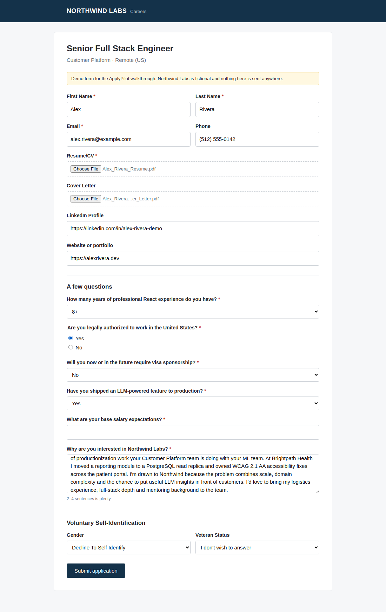

# ApplyPilot

**Paste a job link. Check its work. It applies.**

ApplyPilot reads a job posting, scores how well you fit it, rewrites your resume
and cover letter around it using only facts from your profile, fills the
employer's application form in a real browser, and then stops. Nothing is
submitted until you've reviewed every answer and approved it.

Live page with a walkthrough and an anonymized log of my own job search:
**https://applypilot.mycodedojo.com**



## How it works

1. **Read the posting.** Greenhouse, Lever and Ashby postings come from their
   public APIs, including ones embedded on company career pages. Any other page
   is checked for schema.org `JobPosting` data and then read by Claude.
2. **Score the fit.** A 0–100 fit score with matched and missing skills.
3. **Tailor the documents.** Your real experience is reordered and reworded for
   the role, then rendered to PDF with WeasyPrint. Education, certifications and
   contact details are copied from your profile and never AI-written.
4. **Fill the form.** A Playwright worker opens the application in headed
   Chromium, finds fields by their labels (text, selects, radios, checkboxes,
   ARIA comboboxes, file uploads), uploads the PDFs and answers each question.
   Every answer is tagged with where it came from: profile, saved answer,
   drafted, or unknown.
5. **You approve.** The dashboard shows a screenshot and every answer, with the
   uncertain ones highlighted. Approving queues a submit run that re-fills the
   form with exactly your answers and clicks Submit.

### Guardrails, enforced in code

- Legal and eligibility answers (work authorization, sponsorship, salary) only
  come from answers you've set. If one isn't set, the field stays blank and
  gets flagged.
- The submit run refuses to submit while anything is flagged, or if a question
  appears that you haven't reviewed.
- On multi-page forms, clicking "Next" sends that page to the employer, so later
  pages are only reached during an approved submit run.
- CAPTCHAs are never bypassed. The application is handed back to you.
- Answers you approve are saved to a Q&A bank and reused next time.

## Architecture

```
            ┌──────────────┐  paste link / upload resume   ┌──────────────────┐
  you  ───▶ │  dashboard   │ ────────────────────────────▶ │ intake pipeline  │
            │ Flask :8012  │                               │ fetch→score→tailor│
            └──────┬───────┘                               └────────┬─────────┘
                   │ approve                                         │ PDFs
                   ▼                                                 ▼
            ┌──────────────┐   apply_status queue    ┌───────────────────────┐
            │  jobs.db     │ ◀──────────────────────▶ │ apply worker          │
            │  (SQLite)    │                          │ Playwright + Xvfb     │
            └──────┬───────┘                          └───────────────────────┘
                   │ read-only
                   ▼
            ┌──────────────┐
            │ public API   │ ──▶ applypilot.mycodedojo.com (anonymized log)
            │ Flask :8041  │
            └──────────────┘
```

| Path | What it is |
|---|---|
| `intake/` | Job-link resolution (ATS APIs, JSON-LD, LLM fallback), resume parsing, the tailoring pipeline |
| `apply/` | The browser worker: form discovery and filling (`form.py`), answer planning (`answers.py`), the fill/review/submit loop (`worker.py`) |
| `dashboard/` | Private tracker, profile editor, per-job resume editor, and the review-and-approve modal |
| `documents/` | Resume and cover-letter prompts plus the HTML-to-PDF templates |
| `scoring/`, `sources/`, `main.py` | The daily Adzuna scan, scoring and document generation |
| `public/` | The read-only showcase API, the marketing page, and the demo generator |
| `llm.py` | One helper for every Claude call: structured outputs (JSON schema), server-side refusal fallback, timeouts |

## Run it yourself

Requires Docker and an Anthropic API key.

```bash
git clone https://github.com/mcooper7649/applypilot && cd applypilot
cp .env.example .env                              # add your ANTHROPIC_API_KEY
cp data/profile.example.json data/profile.json    # then edit it, or upload your resume in the dashboard

./dashboard/run.sh     # tracker + profile editor on http://localhost:8012
./apply/run.sh         # the form-filling worker
./daily.sh             # optional: daily Adzuna scan (needs ADZUNA_* keys)
```

> The dashboard has no login of its own. Keep it on your LAN, or put it behind
> a reverse proxy with authentication. It holds your profile and can submit
> applications.

The public showcase is optional: `./public/run.sh` starts the read-only API, and
`public/site/` is a static page that expects it at `/api/`. `public/build_demo.sh`
regenerates the walkthrough from a real run with the fictional candidate in
`public/demo/profile.json`.

## Notes

- Model: `claude-opus-5-5` for intake, form answers and anonymization. The
  scorer and document generator have their own model settings in
  `scoring/scorer.py` and `documents/generator.py`.
- Many ATS forms use invisible reCAPTCHA. When a submission is challenged,
  ApplyPilot marks it "needs you" and keeps the filled screenshot so you can
  finish by hand.
- Workday and LinkedIn Easy Apply need an account login and aren't supported.

## License

MIT
